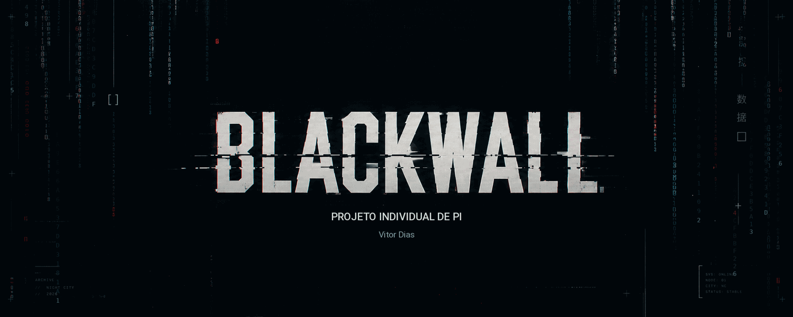

 

**BLACKWALL · ARQUIVOS DE NIGHT CITY**

Projeto individual de **Pesquisa e Inovação (PI)** — Vitor Dias.

---

## 01 // SOBRE O PROJETO

**Blackwall — Arquivos de Night City** é um projeto individual de Pesquisa e Inovação que propõe uma experiência digital inspirada no universo cyberpunk. A ideia é reunir conteúdo, ambientação e narrativa em uma interface que funciona como um arquivo sobre Night City.

O projeto busca uma navegação simples, com foco na leitura e na atmosfera: a estética existe para dar personalidade ao site, não para atrapalhar a experiência.

## 02 // ESTRUTURA DO SITE

O conteúdo é dividido em quatro partes:

| Seção | Conteúdo |
| :-- | :-- |
| **Blackwall** | Página inicial e apresentação do arquivo. |
| **Night City** | A cidade e o universo em que a experiência se passa. |
| **Implantes** | Tecnologia, modificações e temas ligados ao cyberpunk. |
| **Minha História** | Parte pessoal e narrativa do projeto. |

## 03 // OBJETIVOS

- Desenvolver uma experiência web com identidade própria.
- Organizar os conteúdos de maneira clara e intuitiva.
- Trabalhar uma interface responsiva e de fácil navegação.
- Aplicar os conhecimentos adquiridos durante a disciplina de PI.

## 03 // TECNOLOGIAS UTILIZADAS

### Desenvolvimento

### Ferramentas

O desenvolvimento do Blackwall utiliza tecnologias web, com foco em uma interface responsiva, navegação intuitiva e identidade visual própria.

| Tecnologia | Aplicação |
| :-- | :-- |
| **HTML5** | Estruturação das páginas e conteúdos. |
| **CSS3** | Estilização, responsividade e efeitos visuais. |
| **JavaScript** | Interatividade e funcionalidades dinâmicas previstas. |
| **Git / GitHub** | Versionamento e organização do código. |
| **VS Code** | Ambiente de desenvolvimento. |

### Próximas etapas

O projeto também prevê a implementação de funcionalidades com JavaScript e integração com banco de dados MySQL, conforme o avanço das sprints.

## 04 // IDENTIDADE VISUAL

A identidade visual é apresentada separadamente do banner principal. Ela utiliza azul-noturno, ciano, marfim e vermelho de alerta, com referências a terminais e interferência digital.

### Cores

| Cor | Hexadecimal | Uso |
| :-- | :-- | :-- |
| Azul-noturno | `#081922` | Fundo |
| Ciano urbano | `#397B91` | Elementos secundários |
| Névoa fria | `#9BCAD0` | Apoio |
| Marfim analógico | `#D6D5BC` | Textos e destaques |
| Vermelho alerta | `#C83D4D` | Acentos e interferências |

### Tipografia

- **Título e subtítulos:** IBM Plex Mono ou equivalente.
- **Texto:** IBM Plex Sans ou equivalente.

## 05 // ANDAMENTO

O README será atualizado conforme o desenvolvimento do projeto. Tecnologias, funcionalidades e links serão adicionados quando estiverem definidos ou implementados.

<!-- Adicionar links reais quando estiverem disponíveis.
## 06 // LINKS

- [Protótipo](URL)
- [Site](URL)
- [Documentação](URL)
-->

---

BLACKWALL // PROJETO INDIVIDUAL DE PI

